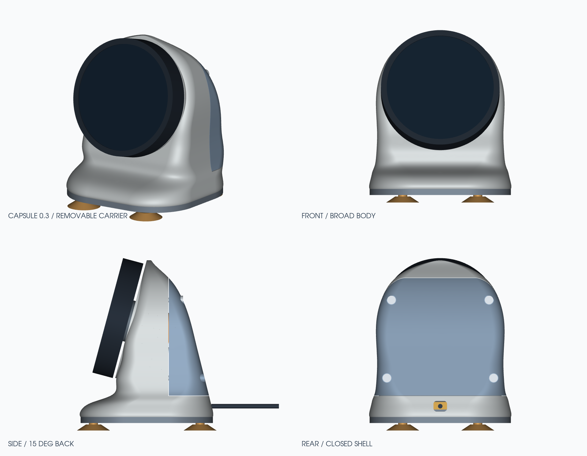
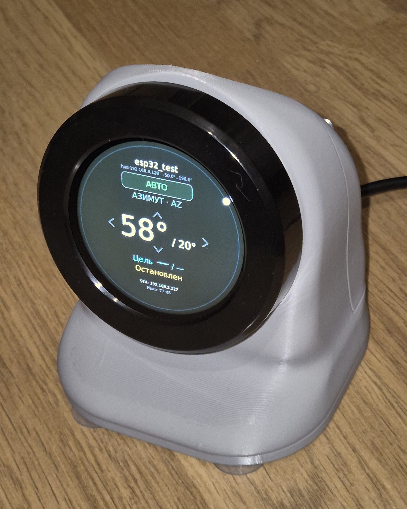
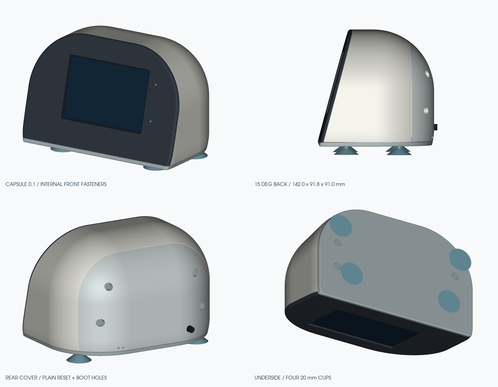

# ESP32 Display Cases

Настольные корпуса для дисплейных модулей ESP32. Репозиторий содержит параметрические исходники CadQuery, инструкции, изображения и базовые модели для пересборки. Скрипты создают полный комплект STL, STEP и автономный 3D-просмотрщик.

| Модуль | Комплект | Конструкция |
|---|---|---|
| [Elecrow CrowPanel 2.1](crowpanel/README.md) | 0.3 | Круглый дисплей с энкодером, съёмный держатель, утяжелитель, магниты и присоски |
| [ESP32-3248S035C](esp32-3248s035c/README.md) | 0.1 | Горизонтальный дисплей 3,5″, кассета интерфейса LDG, кабельный зажим и присоски |

Оба корпуса наклоняют экран на 15° назад от вертикали. Основной материал — PETG, сопло 0,4 мм.

## Корпуса

### Elecrow CrowPanel 2.1

Собранный корпус:

### ESP32-3248S035C

## Скачать и посмотреть

- [3D-предпросмотр в браузере](https://ra3vld.github.io/esp32-cases/)
- [Готовые STEP/STL и полные комплекты](https://github.com/ra3vld/esp32-cases/releases/latest)

## Печать и сборка

1. Открыть инструкцию для своего модуля.
2. Выполнить команды пересборки из инструкции: они создадут полный комплект файлов в `output/`.
3. Подготовить крепёж и сначала напечатать посадочные пробники.
4. Загрузить детали из `output/print_stl/` в слайсер: миллиметры, масштаб 100%.
5. Напечатать детали и собрать корпус по инструкции.

STL из `output/stl/` находятся в координатах сборки; для слайсера использовать `output/print_stl/`. STEP предназначены для редактирования в CAD. HTML-просмотрщик работает локально: открыть сгенерированный файл в браузере с WebGL.

## Изменение моделей

Каждый комплект содержит `parameters.json`, генератор `build.py` и свою инструкцию по установке Python-зависимостей. Команды выполнять из каталога соответствующего комплекта. Размеры в исходниках заданы в миллиметрах.

- [CrowPanel: печать, крепёж, сборка и CAD](crowpanel/mechanical/capsule-v03/README.md)
- [ESP32-3248S035C: печать, крепёж, сборка и CAD](esp32-3248s035c/capsule-v01/README.md)

## Файлы в Git

Для ESP32-3248S035C сохранены восемь STEP деталей и базовые STL деталей 02–07 в двух ориентациях. Эти файлы использует текущая пересборка; их контрольные суммы заданы в `compatibility-baseline.json`. Для CrowPanel используется собственная упрощённая модель `module_reference.py`.

Большие сборочные STEP, HTML-просмотрщики, остальные экспортированные сетки и ZIP-архивы создаются локально и исключены из Git. Генераторы, параметры и команды пересборки общие для локального проекта и клона репозитория.

## Лицензии

Скрипты и код просмотрщиков — [MIT](LICENSE). Наши модели STEP/STL, CAD-параметры, чертежи, документация, рендеры и фотография — [CC BY 4.0](LICENSES/CC-BY-4.0.txt), с указанием автора Dmitry E (RA3VLD). Лицензии допускают коммерческое использование, модификацию и распространение. [Область действия](LICENSES/README.md) и [уведомления о сторонних материалах](THIRD_PARTY_NOTICES.md).

## Обновление 3D-страницы

После пересборки обоих комплектов выполнить `python3 tools/build_site.py`. Компактная статическая страница появится в `.pages-dist/`. Ветка `gh-pages` содержит только готовую страницу; исходники и базовые модели находятся в `main`.
