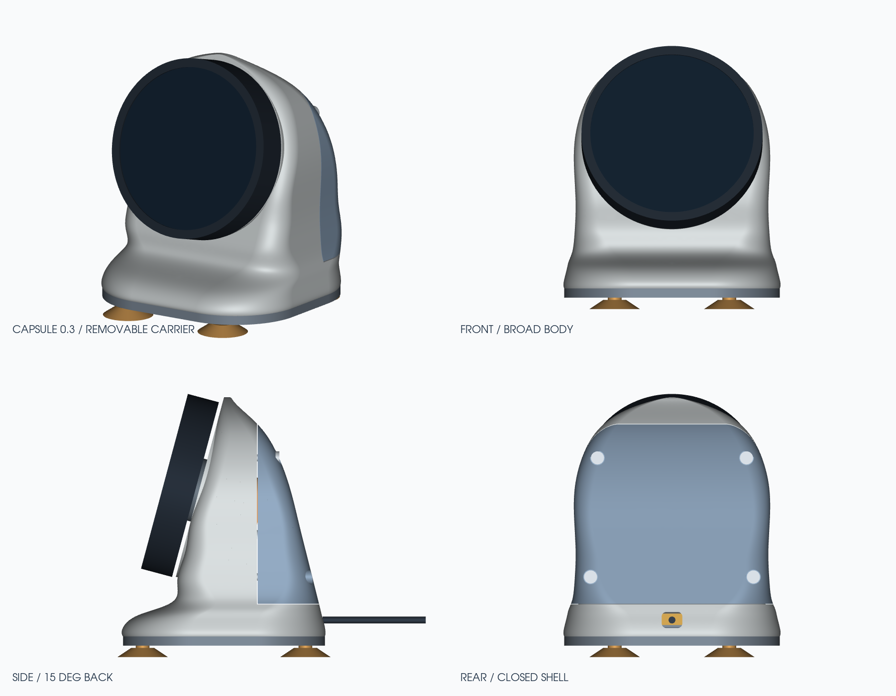

# CrowPanel 2.1 — настольный корпус «Капсула»

Корпус для Elecrow CrowPanel 2.1 с круглым сенсорным экраном и энкодером. Комплект **0.3**: основание 94 × 88 мм, наклон экрана 15° назад, нижний просвет 22 мм. Дисплей установлен на съёмном держателе; задняя и нижняя крышки открывают доступ к разъёмам и крепежу.

Готовый комплект STEP/STL, сборка и HTML-просмотрщик доступны в [релизах](https://github.com/ra3vld/esp32-cases/releases/latest/download/crowpanel-capsule-0.3.zip).

- [Инструкция по печати и сборке, список крепежа](mechanical/capsule-v03/README.md)
- STL для печати: `mechanical/capsule-v03/output/print_stl/`
- STEP деталей: `mechanical/capsule-v03/output/step/` и сборки: `mechanical/capsule-v03/output/assembly.step`
- Автономный 3D-просмотрщик: `mechanical/capsule-v03/output/capsule-3d.html`
- [Разнесённая сборка](mechanical/capsule-v03/output/cad-construction.png)
- [Держатель и крепления крышек](mechanical/capsule-v03/output/reinforcement-preview.png)

Для изготовления нужны PETG, сопло 0,4 мм, 14 термовставок M3 и 17 винтов. В основании предусмотрены стальная пластина 72 × 46 × 10 мм, четыре магнита Ø12 × 3 мм и четыре присоски с хвостиком Ø6 мм. Начать с пробников `05_fit_coupon` и `06_mount_test`.
