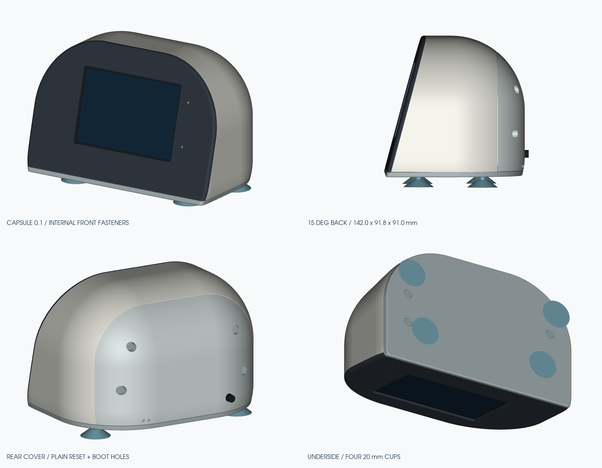

# ESP32-3248S035C — настольный корпус «Капсула»

Корпус для горизонтального дисплея ESP32-3248S035C и интерфейса тюнера LDG размером до 40 × 25 × 25 мм. Комплект **0.1**, габариты 142 × 91,8 × 91 мм без присосок, наклон экрана 15° назад от вертикали.

Полный комплект STL, STEP сборки и HTML-просмотрщик создаются командами из раздела [«Пересборка CAD»](capsule-v01/README.md#пересборка-cad).

Лицевая рамка крепится изнутри. Съёмные задняя крышка и подошва имеют направляющие бортики. Предусмотрены боковой доступ к USB, отверстия RESET/BOOT, раздельные световые каналы датчика и LED, кабельный зажим Ø5 мм и четыре присоски Ø20 мм.

- [Инструкция по печати и сборке, список крепежа](capsule-v01/README.md)
- [STL для печати](capsule-v01/output/print_stl/)
- [STEP деталей](capsule-v01/output/step/) и сборки: `capsule-v01/output/assembly.step`
- [Размерные чертежи, 10 листов](capsule-v01/output/capsule-v01-drawings.pdf)
- Автономный 3D-просмотрщик: `capsule-v01/output/capsule-3d.html`
- [Разнесённая сборка](capsule-v01/output/cad-construction.png)

PETG, сопло 0,4 мм. Перед печатью корпуса использовать пробники `07_fit_coupon` и `08_board_coupon` для подбора посадок и примерки своей платы.
